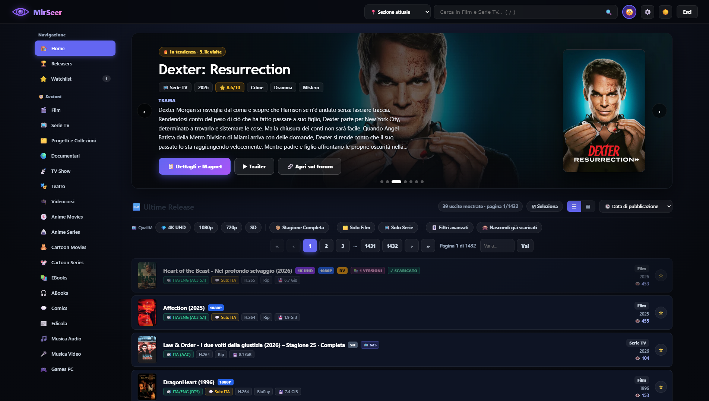
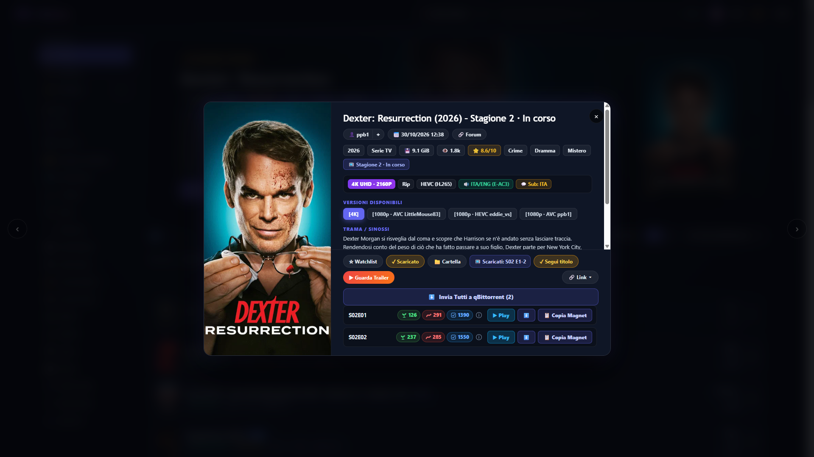

<div align="center">


### Catalogo Multimediale di Nuova Generazione per MirCrew Releases

[](https://github.com/amedeeee/MirSeer/releases)
[](https://opensource.org/licenses/MIT)
[](https://www.tampermonkey.net/)
[](https://mircrew-releases.org)

<p align="center">
  Trasforma l'esperienza di navigazione forum in un'interfaccia fluida, elegante e reattiva in stile Netflix/Prime Video, integrata direttamente nel tuo browser (Desktop e Mobile).
</p>

---

### ⚡ INSTALLAZIONE RAPIDA IN 1 CLIC

[](https://raw.githubusercontent.com/amedeeee/MirSeer/main/mirseer.user.js)

*(Richiede un userscript manager attivo: Tampermonkey, Violentmonkey)*

---

</div>

## 🖼️ Anteprima Interfaccia

<div align="center">
  
  
</div>

---

## ✨ Funzionalità Principali

🎬 **Interfaccia Cinema & Home Personalizzabile**  
Trasforma il forum in un catalogo moderno con design Glassmorphism (tema **Dark / Light**, densità **Comoda / Compatta** e colori d'accento personalizzabili), **Hero Carousel** dinamico per i titoli in tendenza e switch istantaneo tra **Vista Lista** e **Vista Griglia**. Dalle impostazioni puoi scegliere quali sezioni compongono la tua **Home** (Film, Serie TV, Documentari, Anime, Cartoni, ecc.).

▶️ **Streaming su VLC via TorrServer & File Picker**  
Guarda qualsiasi release in streaming istantaneo alla massima qualità originale (4K UHD, HEVC/H.265, 10-bit, HDR/Dolby Vision e audio lossless DTS/TrueHD/Atmos) direttamente su **VLC Media Player** tramite **TorrServer**. Supporta autenticazione HTTP Basic, selezione automatica del file video principale, **File Picker** interattivo per saghe o pack di serie TV (con avvio di singoli episodi o playlist completa), avvio via protocollo diretto `vlc://` o `.m3u`, copia automatica del link negli appunti e **Diagnostica Streaming** integrata.

🎭 **Cast, Regia & Filmography Explorer (TMDb)**  
Nelle schede dettagli di Film e Serie TV compaiono le miniature circolari di regista e cast principale. Cliccando su un nome si apre il **Filmography Explorer** nativo con biografia e filmografia completa, abbinato a un **riscontro in tempo reale su MirCrew** per vedere subito quali titoli sono già disponibili sul forum (con badge dedicati, filtro *Solo su MirCrew* e apertura diretta).

⚖️ **Confronta Versioni & Raggruppamento Intelligente**  
Tutte le release dello stesso titolo vengono raggruppate automaticamente sotto un'unica scheda tramite **ID TMDb** e matching intelligente (anche attraverso più pagine di ricerca e con titoli in lingue diverse). Il pannello **⚖️ Confronta Versioni** permette di analizzare fianco a fianco ogni variante leggendo il MediaInfo (risoluzione, bitrate reale o stimato, HDR/DV, tracce audio, sottotitoli e peso) con punteggio qualità `0–100` e badge automatici (**🏆 Best Quality**, **💡 Best Value**, **🪶 Più leggero**).

⬇️ **Automazione Torrent, Selezione File qBittorrent & Batch**  
Oltre alla copia o apertura rapida del magnet, puoi inviare i download con un clic a **qBittorrent** o **Transmission**, smistandoli automaticamente nelle cartelle di destinazione configurate per sezione o per singola serie TV. Su qBittorrent (v4.5+) puoi anche **selezionare i singoli file da scaricare** prima di avviare un pack, escludendo extra o file indesiderati. Con la **Selezione Multipla** gestisci decine di uscite in blocco.

📊 **Monitoraggio Swarm Live (Seed / Leech)**  
Visualizza in tempo reale lo stato di salute di ciascun torrent prima di scaricarlo o riprodurlo: grazie all'interrogazione diretta dei tracker del forum, badge cromatici dedicati mostrano seed, leech e completamenti attivi.

⭐ **Watchlist, Releasers & Account**  
Salva i tuoi titoli preferiti, segui i tuoi **Releaser** di fiducia (con classifica, statistiche e caricamento diretto delle loro pagine `/releaser/`) o le **serie TV** in corso: MirSeer rileva gli episodi non ancora scaricati segnalandoli con `🆕`. Include inoltre il pannello **Il mio account** con profilo, cronologia download e statistiche personali, oltre a **Backup & Ripristino** JSON (con protezione opzionale delle credenziali).

📱 **Ottimizzazione Mobile & Scorciatoie da Tastiera**  
Interfaccia responsive riprogettata per smartphone con modale a scorrimento unico, tasto Indietro integrato, swipe sull'Hero e sulle schede, e selezione multipla tramite pressione prolungata. Da desktop sono disponibili scorciatoie rapide (`/`, `Ctrl+K`, `j`/`k`, `f`, `d`, `x`, `←`/`→`).

---

## 🚀 Guida all'Installazione

### Passo 1: Installa un Gestore Userscript
Scegli e installa l'estensione browser supportata in base al tuo sistema:

| Browser | Estensione Consigliata | Link Download |
| :--- | :--- | :--- |
| **Google Chrome / Brave** | Tampermonkey | [Chrome Web Store](https://chromewebstore.google.com/detail/tampermonkey/dhdgffkkebhmkfjojejmpbldmpobfkfo) |
| **Mozilla Firefox** | Tampermonkey | [Firefox Add-ons](https://addons.mozilla.org/it/firefox/addon/tampermonkey/) |
| **Microsoft Edge** | Tampermonkey | [Microsoft Edge Add-ons](https://microsoftedge.microsoft.com/addons/detail/tampermonkey/iikmkjmpaadaobahmlepeloendndfphd) |
| **Mobile (Android)** | Tampermonkey | Firefox Mobile / Edge / Lemur / Kiwi Browser |

### Passo 2: Installa lo Script
1. Clicca sul pulsante verde: **[INSTALLA MIRSEER ORA](https://raw.githubusercontent.com/amedeeee/MirSeer/main/mirseer.user.js)**
2. L'estensione aprirà automaticamente la schermata di verifica.
3. Clicca sul tasto **Installa** (o **Conferma installazione**).

### Passo 3: Utilizzo
1. Vai su [mircrew-releases.org](https://mircrew-releases.org) ed effettua l'accesso col tuo account.
2. In basso a destra comparirà il pulsante galleggiante **MirSeer**.
3. Cliccaci sopra per aprire l'interfaccia catalogo.

---

## 🍿 Guida allo Streaming con VLC & TorrServer

Guarda qualsiasi release del forum in **streaming istantaneo alla massima qualità originale** (4K UHD, HDR, Dolby Vision, tracce audio DTS/TrueHD/Atmos) su **VLC Media Player**, senza attendere il completamento del download nel client torrent.

---

### 💡 Come funziona?

I browser web non supportano nativamente il protocollo BitTorrent né i codec video e audio più avanzati (HEVC/H.265 a 10-bit, Dolby Vision, audio AC3/E-AC3/DTS/TrueHD). MirSeer si interfaccia direttamente con **TorrServer** per offrire un'esperienza fluida:

1. **Preparazione & Metadati:** Cliccando su **`▶ Play`**, MirSeer aggiunge il magnet a TorrServer e attende i metadati dai peer (mostrando l'avanzamento a schermo).
2. **Selezione automatica o File Picker:** Se il torrent contiene un solo video (o un film con file extra), MirSeer seleziona automaticamente il file video principale; se contiene più video (saghe, pack serie TV), apre il **File Picker** per scegliere esattamente quale file o episodio riprodurre oppure esportare l'intera playlist in VLC.
3. **Avvio immediato in VLC:** Lo stream viene passato a VLC nella modalità attiva:
   * **⚡ Protocollo `vlc://` (Predefinito su Desktop):** VLC si apre tramite protocol handler di sistema **senza scaricare alcun file `.m3u`**.
   * **📄 Playlist `.m3u` (Alternativa universale / Automatica su Mobile):** Viene generata e scaricata una playlist temporanea da aprire con VLC.
   * *In entrambi i casi, il link di streaming viene copiato automaticamente anche negli appunti per poterlo incollare al volo in VLC (`Apri flusso di rete › Incolla`).*

---

### 🛠️ Requisiti

1. **VLC Media Player** installato sul dispositivo ([videolan.org](https://www.videolan.org/vlc/)).
2. **TorrServer (MatriX)** in esecuzione ([Download da GitHub](https://github.com/YouROK/TorrServer/releases)).
3. **MirSeer v1.4.8** (o superiore).

> ⚠️ **Requisiti per lo Streaming fluido:**  
> Lo streaming tramite TorrServer si basa sulla rete P2P (BitTorrent). Affinché la riproduzione parta rapidamente e senza scatti, **è indispensabile che la release abbia seed attivi**. Se un torrent ha 0 seed o pochissimi peer, il video non potrà caricarsi o andrà in buffering continuo. Per contenuti 4K/Remux ad alto bitrate è necessaria anche una connessione adeguata.

---

### 🚀 Configurazione Passo-Passo

#### 1. Scaricare e avviare TorrServer
1. Vai sulle release di **[TorrServer MatriX](https://github.com/YouROK/TorrServer/releases)**.
2. Scarica il file per il tuo sistema operativo:
   * **Windows:** `TorrServer-windows-amd64.exe` (puoi rinominarlo in `TorrServer.exe`).
   * **macOS:** `TorrServer-darwin-amd64` (o `arm64` per Apple Silicon).
   * **Linux / NAS:** binario corrispondente o container Docker.
3. Posizionalo in una cartella a piacere ed **eseguilo** (lascia la finestra/servizio attivo in background).
4. Verifica che funzioni aprendo nel browser l'indirizzo: `http://127.0.0.1:8090`.

> 💡 **Consiglio RAM:** Dalla dashboard web di TorrServer (`http://127.0.0.1:8090`), apri **Settings** e assegna alla cache di memoria **200 MB** o **500 MB** per ridurre al minimo il rischio di micro-scatti.

---

#### 2. Collegamento in MirSeer
1. Apri MirSeer dal forum premendo il pulsante galleggiante.
2. Clicca sull'icona delle impostazioni **⚙️** in alto a destra.
3. Trova la sezione **"▶ Streaming su VLC (TorrServer)"**.
4. Inserisci l'indirizzo di TorrServer (es. `http://127.0.0.1:8090` in locale, oppure l'IP LAN / Tailscale del server se usi un altro dispositivo).
5. *(Opzionale)* Se il tuo TorrServer ha l'autenticazione attiva, compila i campi **Utente TorrServer** e **Password TorrServer**.
6. Clicca **"🔌 Salva e testa connessione"** fino a visualizzare l'esito positivo verde.  
*(Se Tampermonkey mostra un avviso di connessione verso l'indirizzo inserito, clicca su **"Consenti sempre"**).*

---

#### 3a. Metodo Consigliato su Desktop: Protocollo Diretto `vlc://` (Zero file scaricati)
*Ideale su PC per evitare di accumulare file nella cartella Download.*

1. Nelle impostazioni di MirSeer (**⚙️**), sotto la sezione TorrServer, imposta **Metodo di avvio VLC** su **`⚡ Protocollo vlc://`**.
2. Abilita il riconoscimento dei link `vlc://` sul tuo sistema:

   * **Windows (Configurazione Protocol Handler):**  
     Su Windows il protocollo `vlc://` non è sempre abilitato di default. Se cliccando su Play non si apre VLC:
     1. Scarica un gestore del protocollo per VLC da GitHub ([vlc-protocol](https://github.com/northsea4/vlc-protocol/releases)).
     2. Estrai i file scaricati nella cartella di installazione di VLC (di norma `C:\Programmi\VideoLAN\VLC`) ed esegui `vlc-protocol-register` come amministratore.
     3. Al primo avvio dal browser, quando compare il pop-up *"Aprire VLC media player?"*, spunta **"Consenti sempre ad [indirizzo] di aprire questi tipi di link"** e premi **Apri**.

   * **Linux:** Assicurati che lo schema URL sia associato a VLC digitando nel terminale:  
     ```bash
     xdg-mime default vlc.desktop x-scheme-handler/vlc
     ```

   * **macOS:** Il protocol handler viene generalmente gestito automaticamente dall'applicazione VLC.

---

#### 3b. Metodo Alternativo (e Automatico su Mobile): Playlist `.m3u`
*Consigliato se non vuoi configurare il protocollo di sistema o su smartphone/tablet (dove viene selezionato automaticamente).*

1. Su Desktop, imposta **Metodo di avvio VLC** su **`📄 Playlist .m3u`** nelle impostazioni (**⚙️**).
2. Avvia una riproduzione per scaricare il primo file `.m3u`.
3. Associa l'estensione a VLC:
   * **Windows/macOS:** Fai clic destro sul file scaricato ➔ **Apri con** ➔ Seleziona **VLC** e spunta **"Usa sempre questa app per aprire i file .m3u"**.
   * **Browser Desktop:** Dalle opzioni dei download, seleziona **"Apri sempre i file di questo tipo"**.
   * **Smartphone:** Apri il file `.m3u` scaricato scegliendo **VLC**, oppure apri VLC ➔ **Altro / Rete** ➔ **Apri flusso di rete** e incolla l'URL già copiato negli appunti da MirSeer.

---

#### 4. Buona visione e Diagnostica
1. Apri la scheda di un video e premi **`▶ Play`** (oppure **`▶ Play`** sul singolo episodio desiderato).
2. Attendi l'eventuale caricamento dei metadati del torrent (se l'attesa supera i 3,5 secondi comparirà il tasto di conferma **`▶ Apri in VLC`**).
3. Se VLC dovesse mostrare un errore, clicca sul chip **`🔬 VLC dà errore? Diagnostica`** che compare in basso per eseguire un controllo completo (raggiungibilità del server, login, peer attivi, verifica reale del flusso video e report copiabile).

---

## ⚙️ Configurazione TMDb (Consigliata)

MirSeer funziona anche senza chiavi esterne estraendo locandine e trame direttamente dai post. Inserendo una **API Key gratuita di TheMovieDatabase (TMDb)** si attivano però tutte le funzioni avanzate:

- Locandine HD e fondali (Backdrop) nell'Hero e nelle schede
- Trame ufficiali in italiano, valutazioni medie, generi e **Trailer YouTube**
- **Bolle Cast & Regia** e **Filmography Explorer** con riscontro su MirCrew
- **Raggruppamento versioni tramite ID TMDb** e filtri avanzati per voto/genere

**Come attivarla:**
1. Registra un account gratuito su [TheMovieDatabase (TMDb)](https://www.themoviedb.org/).
2. Vai su **Impostazioni > API** e genera una chiave personale (*API Key v3*).
3. Apri le impostazioni di MirSeer (**⚙️**) dentro il catalogo.
4. Incolla la tua chiave nel campo **TMDb API Key** e clicca **💾 Salva**.

---

## ❓ Domande Frequenti (FAQ) & Risoluzione Problemi

<details>
<summary><b>Lo script rallenta o non estrae le copertine.</b></summary>
Verifica che estensioni AdBlocker (uBlock Origin, AdGuard) o DNS filtranti (Pi-hole) non stiano bloccando host di immagini esterni spesso usati dai releaser (es. Postimages, ImgBB, TurboImageHost) o il dominio <code>image.tmdb.org</code>.
</details>

<details>
<summary><b>MirSeer funziona da smartphone?</b></summary>
Sì! L'interfaccia è ottimizzata per schermi touch e smartphone. È sufficiente usare un browser mobile Android con supporto alle estensioni (es. <b>Firefox Mobile</b>, <b>Microsoft Edge</b>, <b>Lemur Browser</b> o <b>Kiwi Browser</b>) con Tampermonkey o Violentmonkey installato.
</details>

<details>
<summary><b>Come aggiorno lo script?</b></summary>
Lo script si aggiorna in automatico in background ogni 24 ore. Per forzare l'aggiornamento immediato, apri la dashboard di Tampermonkey, individua "MirSeer" e seleziona <i>Operazioni > Verifica aggiornamenti</i>.
</details>

<details>
<summary><b>VLC non si avvia o mostra errori di riproduzione?</b></summary>
Dopo aver premuto <code>▶ Play</code>, usa il pulsante <b>🔬 VLC dà errore? Diagnostica</b> che compare sullo schermo: controllerà automaticamente se TorrServer è raggiungibile, se servono credenziali, quanti peer/seed rispondono e se il flusso video parte correttamente. Ricorda inoltre che l'URL viene copiato automaticamente negli appunti, quindi puoi sempre aprire VLC e usare <i>Apri flusso di rete › Incolla</i>.
</details>

<details>
<summary><b>Il video va a scatti o si interrompe?</b></summary>
Controlla i badge seed/leech nella scheda della release: un torrent senza seed sufficienti non può garantire uno streaming fluido. In alternativa, metti in pausa VLC per qualche secondo all'avvio per permettere a TorrServer di riempire il buffer in memoria RAM.
</details>

<details>
<summary><b>Posso usarlo da un altro dispositivo (es. da telefono verso PC/NAS o tramite Tailscale)?</b></summary>
Sì! Avvia TorrServer sul PC, server o NAS e inserisci nelle impostazioni di MirSeer sul telefono l'indirizzo di rete del server (es. <code>http://192.168.1.50:8090</code> in LAN oppure l'IP/hostname Tailscale) invece di <code>127.0.0.1</code>.
</details>

---

## 📄 Licenza

Distribuito sotto licenza **MIT**. Consulta il file [`LICENSE`](LICENSE) per ulteriori dettagli.

<div align="center">
  <sub>Realizzato per la community con dedizione e codice pulito. MirSeer non ospita file protetti da copyright: si limita a organizzare i metadati pubblici del forum.</sub>
</div>
