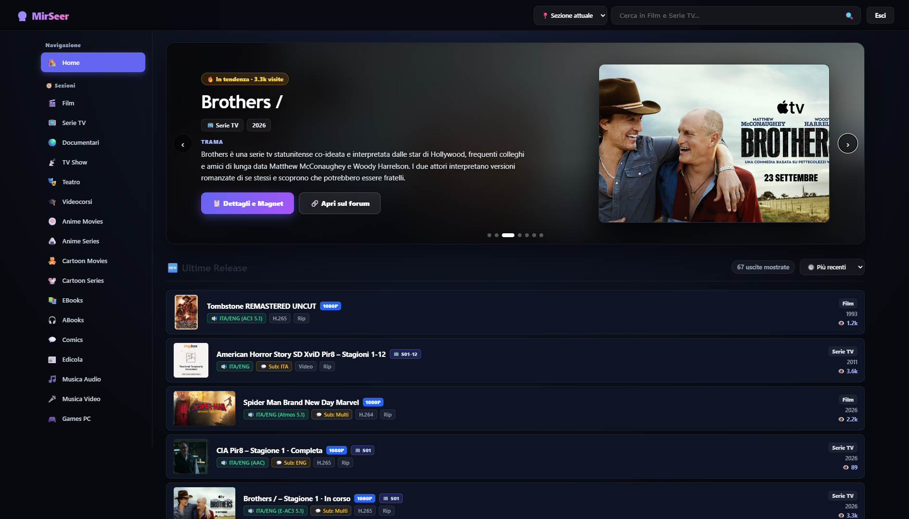
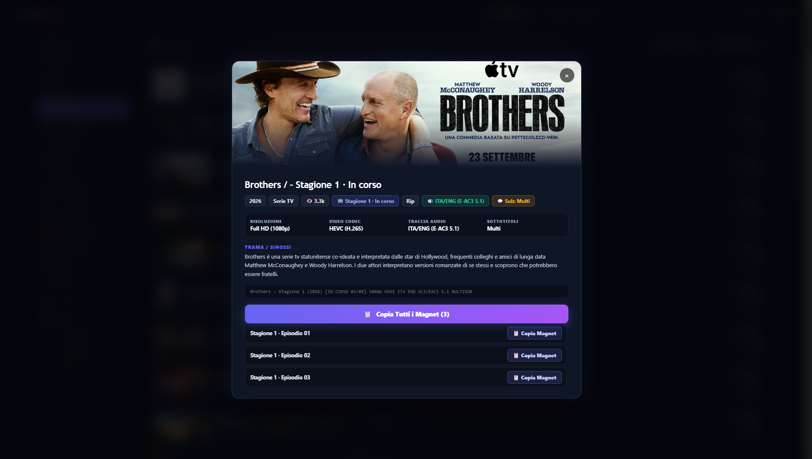

### Catalogo Multimediale di Nuova Generazione per MirCrew Releases

  Trasforma l'esperienza di navigazione forum in un'interfaccia VOD fluida, elegante e reattiva in stile Netflix/Prime Video, integrata direttamente nel tuo browser.

---

### ⚡ INSTALLAZIONE RAPIDA IN 1 CLIC

*(Richiede un userscript manager attivo: Tampermonkey, Violentmonkey)*

---

## 🖼️ Anteprima Interfaccia

  
  

---

## ✨ Funzionalità Principali

🎬 **Interfaccia Cinema (Lista, Griglia & Carosello)** Trasforma il forum in un vero e proprio catalogo in stile Netflix/Plex. Layout moderno con design Glassmorphism (disponibile in modalità Dark e Light con accenti cromatici personalizzabili), Hero Carousel dinamico per i titoli in tendenza e massima libertà di scelta tra la visualizzazione a lista classica o la Vista a Griglia a sole locandine.

▶️ **Streaming Istantaneo (Webtor, VLC & TorrServer)** Guarda i contenuti video in streaming immediato senza attendere il download. Include un player Webtor integrato per la riproduzione diretta nel browser e il supporto a VLC tramite TorrServer per le release più impegnative (4K UHD, HEVC, 10-bit, HDR/Dolby Vision e audio lossless DTS/Atmos), assistito da un router intelligente e da un watchdog che rileva blocchi o errori di buffering.

🍿 **Metadati Avanzati, Voti & Trailer (Integrazione TMDb)** Algoritmo intelligente che bypassa banner promozionali, userbar e firme dei releaser per estrarre i dati reali del post. Arricchisce ogni titolo con locandine HD, trame ufficiali in italiano da TMDb, valutazioni medie, generi e permette di riprodurre i Trailer YouTube in un player a comparsa senza mai uscire dalla pagina.

⬇️ **Automazione Torrent, WebUI & Invio Multiplo** Gestione granulare dei Magnet link per singoli episodi o intere stagioni. Oltre alla copia rapida negli appunti, puoi inviare i download con un clic a qBittorrent o Transmission, smistandoli automaticamente nelle tue cartelle di destinazione (es. `/Media/Film` o `/Media/SerieTV`). La modalità Selezione Multipla (Batch) consente di copiare o inviare decine di uscite contemporaneamente.

📊 **Monitoraggio Swarm Live (Seed / Leech)** Visualizza in tempo reale lo stato di salute di ciascun torrent prima ancora di scaricarlo. Grazie all'interrogazione diretta dei tracker del forum, appositi badge cromatici mostrano con precisione il numero di seed, leech e completamenti attivi, segnalando tempestivamente le release senza fonti.

⭐ **Watchlist Intelligente & Tracciamento Serie** Salva i tuoi titoli preferiti e segui con un clic i tuoi Releaser di fiducia o le serie TV in corso. MirSeer rileva in automatico gli episodi che non hai ancora scaricato contrassegnandoli con il badge "🆕 Nuovo", mentre il marcatore visivo "Scaricato" (✓) e il database locale su IndexedDB mantengono ordinata la tua cronologia.

🔍 **Ricerca Universale, Filtri Rapidi & Statistiche** Motore di ricerca rapido con correzione fuzzy e supporto scorciatoie da tastiera (`/`, `Ctrl+K`, `j`/`k`). Isola qualsiasi contenuto con i filtri rapidi (4K UHD, 1080p, HDR/DV, Audio ITA, Stagioni complete, genere, anno e codec), con accesso a una dashboard statistica personale che analizza lo spazio scaricato e i tuoi formati preferiti.

---

## 🚀 Guida all'Installazione

### Passo 1: Installa un Gestore Userscript
Scegli e installa l'estensione browser supportata in base al tuo sistema:

| Browser | Estensione Consigliata | Link Download |
| :--- | :--- | :--- |
| **Google Chrome / Brave** | Tampermonkey | [Chrome Web Store](https://chromewebstore.google.com/detail/tampermonkey/dhdgffkkebhmkfjojejmpbldmpobfkfo) |
| **Mozilla Firefox** | Tampermonkey | [Firefox Add-ons](https://addons.mozilla.org/it/firefox/addon/tampermonkey/) |
| **Microsoft Edge** | Tampermonkey | [Microsoft Edge Add-ons](https://microsoftedge.microsoft.com/addons/detail/tampermonkey/iikmkjmpaadaobahmlepeloendndfphd) |
| **Android (Kiwi / Firefox)** | Tampermonkey | Installabile dallo store del rispettivo browser |

### Passo 2: Installa lo Script
1. Clicca sul pulsante verde: **[INSTALLA MIRSEER ORA](https://raw.githubusercontent.com/amedeeee/MirSeer/main/mirseer.user.js)**
2. L'estensione aprirà automaticamente la schermata di verifica.
3. Clicca sul tasto **Installa** (o **Conferma installazione**).

### Passo 3: Utilizzo
1. Vai su [mircrew-releases.org](https://mircrew-releases.org) ed effettua l'accesso col tuo account.
2. In basso a destra comparirà il pulsante galleggiante circolare **🔮 MirSeer**.
3. Cliccaci sopra per aprire l'interfaccia catalogo.

---

## 🍿 Guida allo Streaming con VLC & TorrServer

Guarda qualsiasi release del forum in **streaming istantaneo alla massima qualità originale** (4K UHD, HDR, Dolby Vision, tracce audio DTS/Atmos) su **VLC Media Player**, senza attendere il completamento del download nel client torrent.

---

### 📹 Video Tutorial

<!-- Sostituisci questo blocco con il tuo video (embed YouTube o file video) -->

*Fai clic sull'anteprima per visualizzare il video tutorial passo-passo*

---

### 💡 Come funziona?

I browser non supportano nativamente lo streaming torrent né formati video complessi (HEVC a 10-bit, audio lossless DTS/TrueHD, file 4K pesanti). 

MirSeer supera questo limite interfacciandosi con **TorrServer**:
1. Clicchi su **"▶ Play"** in MirSeer e scegli **VLC**.
2. MirSeer ordina a TorrServer di avviare il buffering sequenziale in RAM del torrent.
3. Viene generata e scaricata istantaneamente una playlist `.m3u`.
4. **VLC si apre da solo** e riproduce il flusso video in streaming alla massima qualità.

---

### 🛠️ Requisiti

1. **VLC Media Player** installato sul sistema ([videolan.org](https://www.videolan.org/vlc/)).
2. **TorrServer (MatriX)** in esecuzione ([Download da GitHub](https://github.com/YouROK/TorrServer/releases)).
3. **MirSeer v1.4.6** (o superiore).

---

### 🚀 Configurazione Passo-Passo

#### 1. Scaricare e avviare TorrServer
1. Vai sulle release di **[TorrServer MatriX](https://github.com/YouROK/TorrServer/releases)**.
2. Scarica il file per il tuo sistema operativo:
   * **Windows:** `TorrServer-windows-amd64.exe` (rinominalo in `TorrServer.exe`).
   * **macOS:** `TorrServer-darwin-amd64` (o `arm64` per Apple Silicon).
   * **Linux / NAS:** binario corrispondente o container Docker.
3. Posizionalo in una cartella a piacere ed **eseguilo** (lascia la finestra aperta in background).
4. Verifica che funzioni aprendo nel browser l'indirizzo: `http://127.0.0.1:8090`.

> 💡 **Consiglio RAM:** Dalla dashboard web di TorrServer (`http://127.0.0.1:8090`), apri **Settings** e assegna alla cache di memoria **200 MB** o **500 MB** per eliminare ogni rischio di micro-scatti.

#### 2. Collegamento in MirSeer
1. Apri MirSeer dal forum premendo il pulsante galleggiante viola.
2. Clicca sull'icona delle impostazioni **⚙️** in alto a destra.
3. Trova la sezione **"▶ Streaming su VLC (TorrServer)"**.
4. Inserisci l'indirizzo di TorrServer (di default: `http://127.0.0.1:8090`).
5. Clicca **"🔌 Salva e testa connessione"** fino a visualizzare l'esito positivo verde.
*(Se Tampermonkey mostra una richiesta di connessione verso 127.0.0.1, clicca su **"Consenti sempre"**).*

#### 3. Associazione file per l'apertura a 1 clic
1. Avvia una riproduzione per scaricare il tuo primo file `.m3u`.
2. Fai clic destro sul file scaricato ➔ **Apri con** ➔ Seleziona **VLC** e spunta **"Usa sempre questa app per aprire i file .m3u"**.
3. Dalle opzioni download del browser, seleziona **"Apri sempre i file di questo tipo"**.
*(In questo modo non dovrai più aprire i file manualmente: VLC si avvierà da solo).*

#### 4. Buona visione!
1. Apri la scheda di un video e premi **"▶ Play (Browser / VLC)"** (oppure **"▶ Play"** sul singolo episodio desiderato).
2. Nel menu rapido seleziona **"▶ Apri con VLC"**.
3. VLC si avvierà in pochi istanti con lo streaming pronto.

---

## ⚙️ Configurazione TMDb (Opzionale)

MirSeer funziona nativamente senza chiavi esterne. Tuttavia, per abilitare i fondali ad alta risoluzione (Backdrop) e il recupero automatico della trama originale nei topic più datati, puoi inserire una API Key gratuita di TheMovieDatabase (TMDb):

1. Registra un account gratuito su [TheMovieDatabase (TMDb)](https://www.themoviedb.org/).
2. Vai su **Impostazioni > API** e genera una chiave personale (*API v3 auth*).
3. Apri la schermata impostazioni di MirSeer cliccando sull'icona ingranaggio ⚙️ dentro il catalogo.
4. Incolla la tua chiave nel campo **TMDb API Key** e clicca **Salva**.

---

## ❓ Domande Frequenti (FAQ) & Risoluzione Problemi

<b>Lo script rallenta o non estrae le copertine.</b>

Verifica che le estensioni AdBlocker (uBlock Origin, AdGuard) o firewall DNS (Pi-hole) non stiano bloccando host di immagini esterni (es. Postimages, ImgBB, TurboImageHost) spesso usati dai releaser.

<b>MirSeer funziona da smartphone?</b>

Sì! È sufficiente usare un browser mobile con supporto alle estensioni Chrome/Firefox come <b>Kiwi Browser</b> o <b>Firefox Mobile Nightly</b> con Tampermonkey installato.

<b>Come aggiorno lo script?</b>

Lo script si aggiorna in automatico in background ogni 24 ore. Per forzare l'aggiornamento immediato, apri la dashboard di Tampermonkey, individua "MirSeer" e seleziona <i>Operazioni > Verifica aggiornamenti</i>.

<b>VLC non si avvia o mostra errori di rete?</b>

Verifica che TorrServer sia aperto in background e che il firewall del sistema operativo (o l'antivirus) non stia bloccando la porta <code>8090</code>. Esegui nuovamente il test di connessione nelle impostazioni di MirSeer per verificare che risponda correttamente.

<b>Il video va a scatti o si interrompe?</b>

Controlla il badge dei seed in MirSeer: un torrent privo di fonti sufficienti non può garantire uno streaming fluido. In alternativa, metti in pausa VLC per qualche secondo all'avvio per permettere a TorrServer di riempire il buffer in memoria RAM.

<b>Funziona anche su rete locale o verso TV?</b>

Sì! Eseguendo TorrServer su un server locale o NAS (es. <code>http://192.168.1.50:8090</code> o tramite Tailscale), il file <code>.m3u</code> generato da MirSeer sarà riproducibile da qualsiasi dispositivo dotato di VLC connesso alla medesima rete.

---

## 📄 Licenza

Distribuito sotto licenza **MIT**. Consulta il file [`LICENSE`](LICENSE) per ulteriori dettagli.

  Realizzato per la community con dedizione e codice pulito. MirSeer non ospita file protetti da copyright: si limita a organizzare i metadati pubblici del forum.

